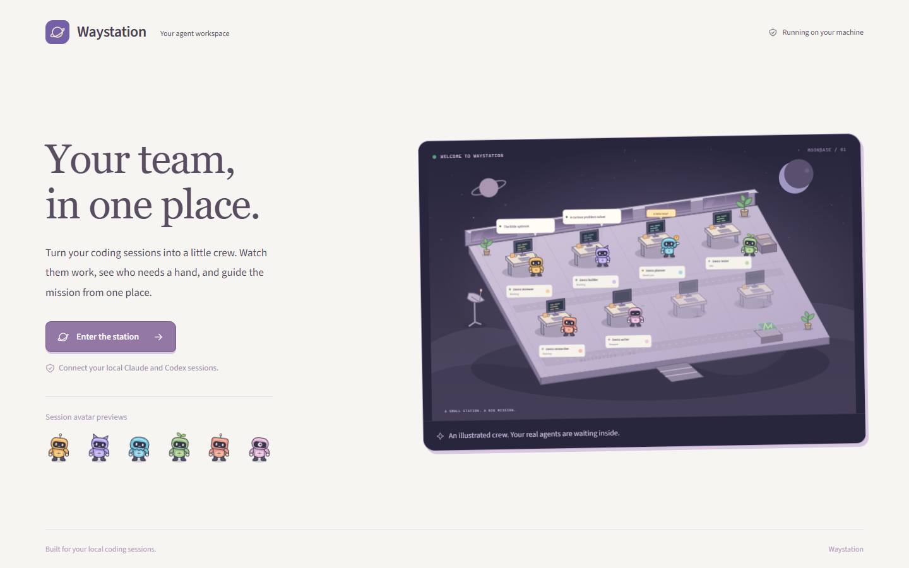
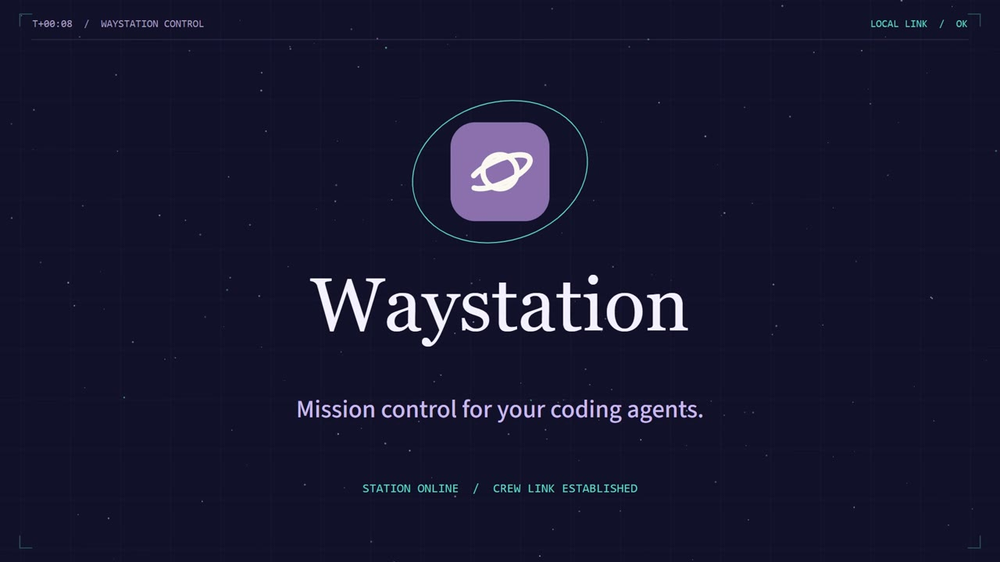
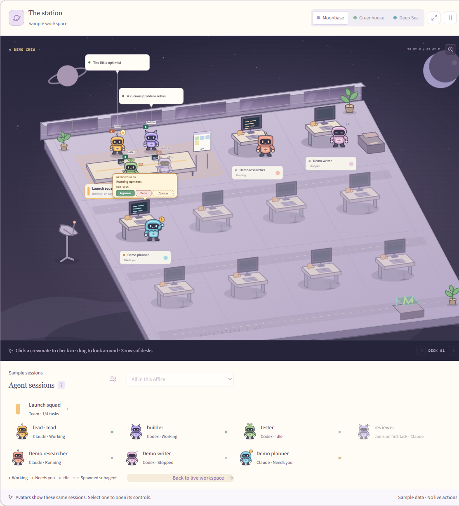
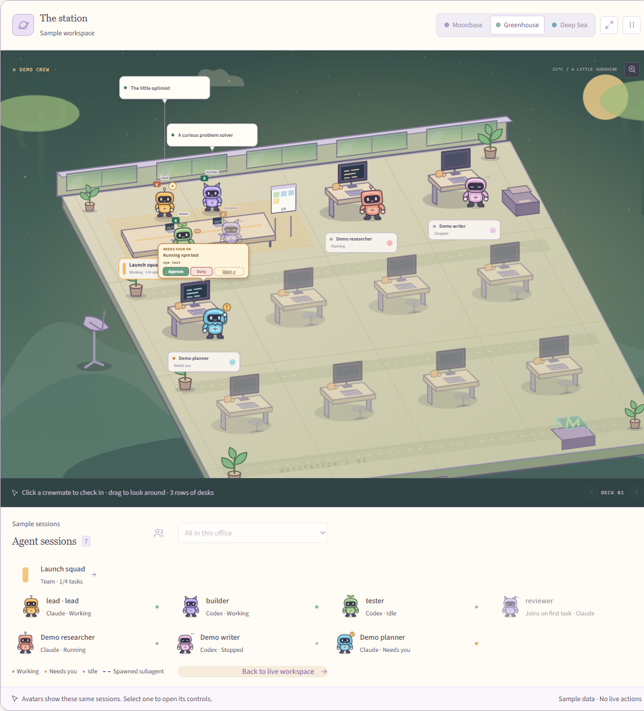
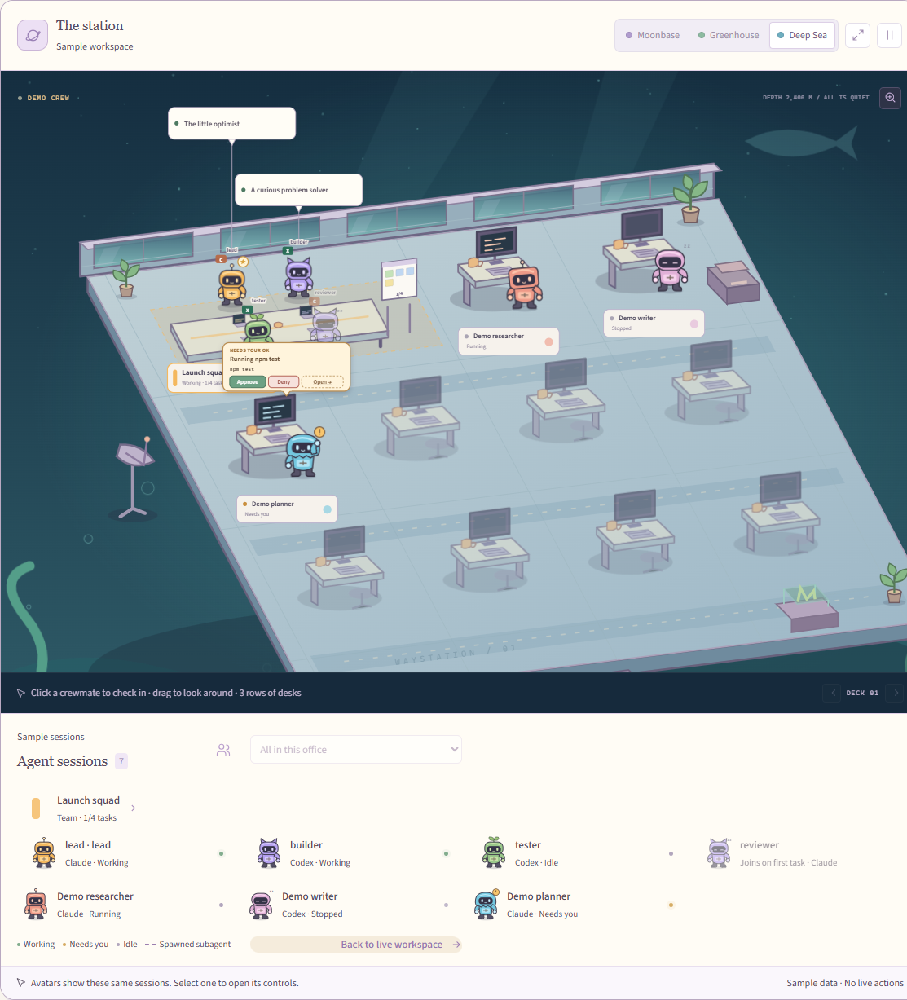
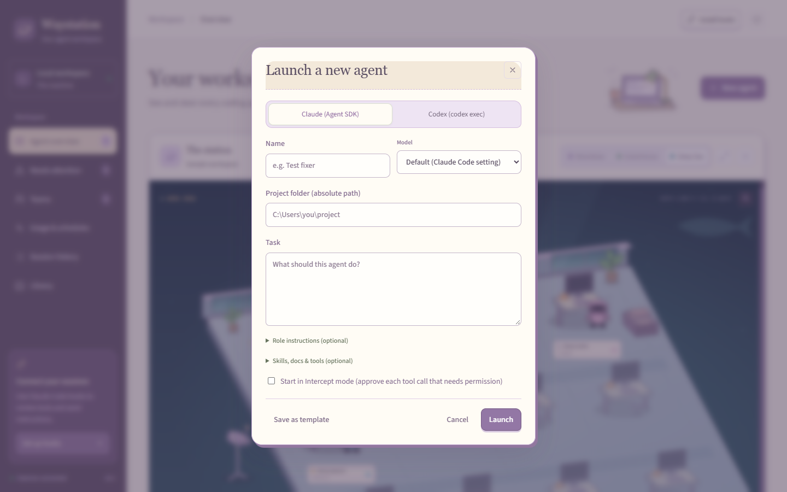
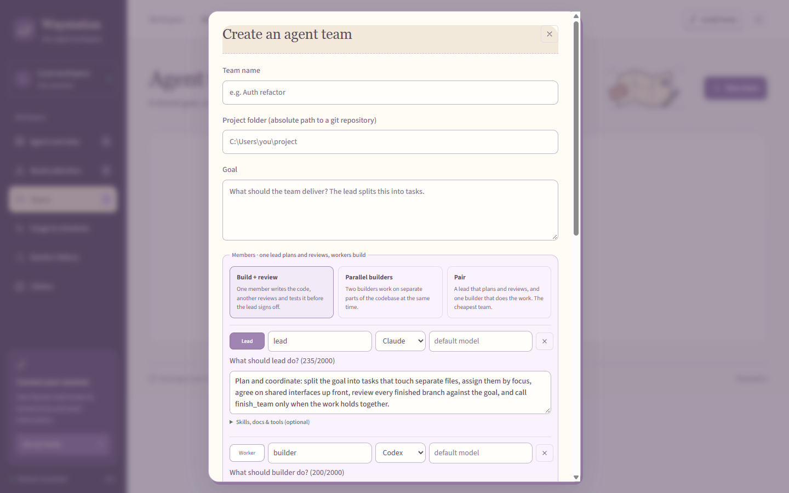

<div align="center">


# Waystation

### See and steer every coding agent on your machine from one place.

Claude Code, Codex, and more, working side by side as a small illustrated crew.
Approve their tool calls, send them instructions, and run mixed Claude + Codex teams from one local dashboard.


[**Quick start**](#-quick-start) · [**Features**](#-why-waystation) · [**Screenshots**](#-a-closer-look) · [**Full guide**](Agent_Inspection/README.md) · [**Report an issue**](https://github.com/dolamquan/waystation/issues)

<br />



<br />

<a href="video/promo/out/waystation-promo.mp4">
  
</a>

<sub>▶ <a href="video/promo/out/waystation-promo.mp4"><b>Watch the 50-second promo</b></a></sub>

</div>

<br />

> [!NOTE]
> **Waystation is an early preview.** It's ready for you to clone and try, but expect rough edges. Feedback and bug reports are very welcome in [Issues](https://github.com/dolamquan/waystation/issues).

---

## ✨ Why Waystation?

If you run several coding agents at once, you end up juggling terminal tabs, VS Code panels, and permission prompts. Waystation gathers all of them into one view so you can tell at a glance **who is working, who is stuck, and who needs you**.

<table>
<tr>
<td width="50%" valign="top">

### 🛰️ One view across vendors
Claude Code, Codex, Aider, Gemini CLI, Cursor Agent, OpenCode and Goose all appear together, whether they run in a terminal, VS Code, or from Waystation itself.

</td>
<td width="50%" valign="top">

### ✋ Intercept and approve
Hold an agent's next tool call, then **approve**, **edit its input**, or **deny it with an instruction**. You can also message, stop, or delegate any agent.

</td>
</tr>
<tr>
<td width="50%" valign="top">

### 👥 Mixed agent teams
Put a Claude lead, a Codex builder, and a Claude reviewer on one goal. They share a task board and message each other. Each works in its own **git worktree**, and nothing is merged until you choose to merge it.

</td>
<td width="50%" valign="top">

### 🛡️ Runaway guard and costs
Every card shows the model, an estimated cost, and how full its context is. The guard steps in when an agent loops, keeps failing, or goes over a spend limit.

</td>
</tr>
<tr>
<td width="50%" valign="top">

### 🗂️ Session history and resume
Search past conversations, review diffs and checks, and resume a closed Claude or Codex session with its original context.

</td>
<td width="50%" valign="top">

### 🔒 Local first
The dashboard listens on `127.0.0.1` only, behind a token that changes on every run. Your accounts, sessions, and keys never leave your machine.

</td>
</tr>
</table>

---

## 🪐 The station

Live sessions appear as a crew of original characters (Pip, Mica, Orbit, Sprout, Bolt and Nova), with an office for each project folder. Working agents type, agents that need you wave, idle ones stroll, and stopped ones sleep. Tool calls waiting for approval pop up right in the scene.

<div align="center">

</div>

Pick the environment that suits you:

<table>
<tr>
<td align="center" width="50%">

<br /><b>Greenhouse</b>
</td>
<td align="center" width="50%">

<br /><b>Deep Sea</b>
</td>
</tr>
</table>

> [!TIP]
> No agents running yet? Click **Explore the demo** under the station to see a labeled sample crew. It doesn't launch anything.

---

## 🚀 Quick start

### Requirements

| | Requirement | Notes |
|---|---|---|
| 🪟 | **Windows 10 or 11** | macOS and Linux aren't supported yet |
| 🟢 | **[Node.js](https://nodejs.org) 22.20 or newer** | Check with `node --version` |
| 🔧 | **[Git](https://git-scm.com)** | Needed for cloning and for agent teams |
| 🤖 | **[Claude Code](https://docs.claude.com/en/docs/claude-code/overview)** | Installed and signed in with your own account |
| ⚙️ | [Codex CLI](https://github.com/openai/codex) *(optional)* | Only if you want Codex agents |

### Install and run

```powershell
git clone https://github.com/dolamquan/waystation.git
cd waystation/Agent_Inspection
npm ci
npm run desktop
```

Waystation opens in its own window. On first launch, **Desktop setup** checks your tools and explains how to connect your agent accounts. A missing optional tool won't stop it from running.

> [!IMPORTANT]
> The first `npm ci` downloads Electron (about 100 MB), so expect it to take a minute or two.

<details>
<summary><b>Prefer the browser instead of the desktop window?</b></summary>

<br />

```powershell
npm start               # builds the UI if needed, starts Waystation, opens your browser
npm start -- --no-open  # start without opening a browser; use `npm run open` later
```

Press <kbd>Ctrl</kbd>+<kbd>C</kbd> in the terminal to stop it.

</details>

### Connect your existing Claude Code sessions

Click **Install hooks** in the top bar. Waystation adds a small hook to `~/.claude/settings.json` (after backing it up) so it can show, intercept, and instruct the Claude Code sessions you already run in a terminal or VS Code. **Remove hooks** takes them back out.

### Stopping Waystation

Closing the window keeps Waystation running in the system tray. To shut it down, right-click the tray icon and choose **Quit Waystation**.

---

## 🔍 A closer look

<table>
<tr>
<td width="50%" valign="top">

<p align="center"><b>Launch an agent</b><br /><sub>Start a Claude (Agent SDK) or Codex agent with a model, a task, optional role instructions, and Intercept mode.</sub></p>
</td>
<td width="50%" valign="top">

<p align="center"><b>Build a team</b><br /><sub>Pick a team shape (Build + review, Parallel builders, Pair) and mix Claude and Codex members.</sub></p>
</td>
</tr>
</table>

### How much control do you get?

| Badge | Which agents | See live | Intercept / instruct | Stop |
|---|---|:---:|:---:|:---:|
| **Full control** | Agents launched from **+ New agent** | ✅ | ✅ | ✅ |
| **Hook control** | Your own Claude Code sessions (terminal or VS Code) | ✅ | ✅ after installing hooks | ✅ |
| **Observe only** | Editor Codex threads, Aider, Gemini CLI, Cursor Agent, OpenCode, Goose | ✅ | — | CLIs only |

---

## 🧭 How it works

```
 ┌──────────────┐  hooks / SDK / transcripts  ┌─────────────────────┐  token-protected  ┌──────────────┐
 │ Claude Code  │ ──────────────────────────▶ │                     │ ◀───────────────▶ │ Desktop app  │
 │ Codex        │                             │  Waystation daemon  │  HTTP + WebSocket │  or browser  │
 │ Aider, ...   │ ◀─── approvals, messages ── │  (127.0.0.1 only)   │                   │      UI      │
 └──────────────┘                             └─────────────────────┘                   └──────────────┘
                                                         │ local SQLite
                                                         ▼
                                              %LOCALAPPDATA%\agent-tower
```

- A local **daemon** (Node + TypeScript) discovers sessions from Claude Code's session registry and transcripts, Codex rollouts, and the process list.
- **Managed agents** run through the Claude Agent SDK or `codex exec`, which gives full control over each tool call.
- Your **existing Claude Code sessions** report in through a small hook script. If Waystation isn't running, Claude Code behaves exactly as before.
- The **UI** is React + Framer Motion, served to an Electron window or your browser.
- Runtime data (database, per-run token, backups) is kept in `%LOCALAPPDATA%\agent-tower`, outside your repositories.

---

## 🛠️ Troubleshooting

<details>
<summary><b><code>npm ci</code> fails or Electron won't download</b></summary>

<br />

Make sure you're on Node 22.20 or newer (`node --version`) and running from the `Agent_Inspection` folder. If you're behind a proxy, Electron's download may need `ELECTRON_MIRROR` or proxy settings for npm.

</details>

<details>
<summary><b>My Claude Code sessions don't show up</b></summary>

<br />

Sessions started *before* you clicked **Install hooks** may need a restart to pick up the hooks. If `claude.exe` isn't in the npm global folder or on `PATH`, set `AGENT_TOWER_CLAUDE_EXE` to its location.

</details>

<details>
<summary><b>Teams refuse my project folder</b></summary>

<br />

The folder must be the top of its own git repository, not a subfolder of a larger one. If it isn't a repo yet, tick **Set up git** in the New team dialog. Worktrees only contain committed files, so commit first.

</details>

<details>
<summary><b>Where is my data stored? How do I reset?</b></summary>

<br />

Everything is in `%LOCALAPPDATA%\agent-tower`. Quit Waystation and delete that folder for a clean start. Remove hooks first if you installed them.

</details>

More detail is in the [desktop setup guide](Agent_Inspection/docs/desktop.md) and the [full feature guide](Agent_Inspection/README.md).

---

## ⚠️ Known limits

- **Windows only** for now.
- **Team sandboxes prevent accidents, but they aren't a security boundary.** Members run as your Windows user. Treat Intercept on team members as a convenience.
- Managed agents load your user Claude settings (plugins, MCP servers, global hooks), so each turn may be slower and cost more.
- Costs are **estimates** at list price. Subscription plans are billed differently.

---

## 🧑‍💻 Development

```powershell
cd Agent_Inspection
npm run daemon:dev   # daemon that also trusts the Vite dev server
npm run dev:web      # Vite dev server on http://127.0.0.1:5173
npm test             # Vitest unit + integration tests
npm run typecheck
```

The project layout and the full feature reference are in [`Agent_Inspection/README.md`](Agent_Inspection/README.md).

---

## 💬 Feedback

This is an early preview, and testers make it better. If something breaks, confuses you, or you have an idea, please [open an issue](https://github.com/dolamquan/waystation/issues). Screenshots help a lot.

## 📄 License

A license hasn't been chosen yet. Until one is added, you're welcome to clone and try Waystation, but please ask before redistributing or reusing the code. The bundled [Source Sans 3](https://github.com/adobe-fonts/source-sans) font is under the SIL Open Font License (`Agent_Inspection/web/public/fonts/SourceSans3-LICENSE.md`).

<div align="center">
<br />
<sub>Built for people who run more agents than they have terminal tabs. 🛰️</sub>
</div>
