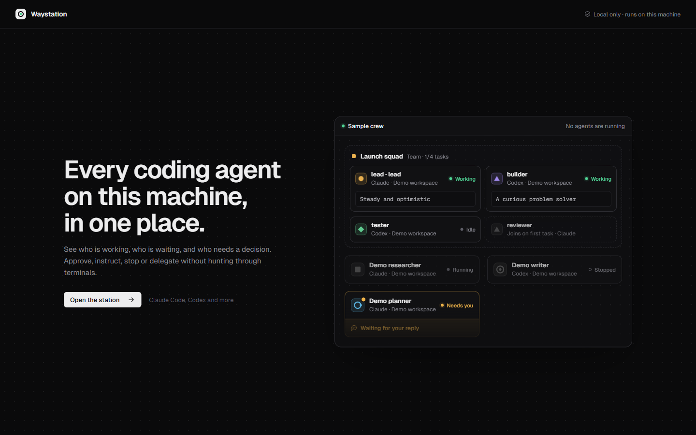
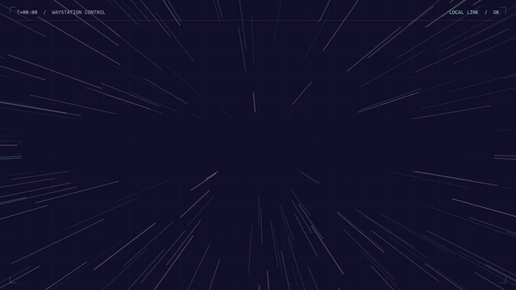
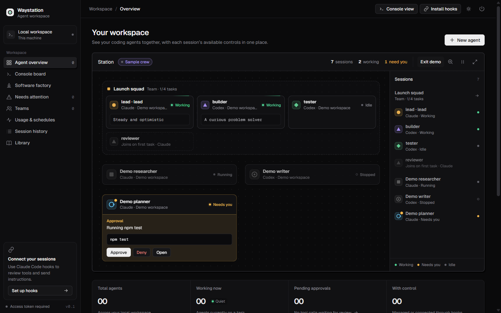
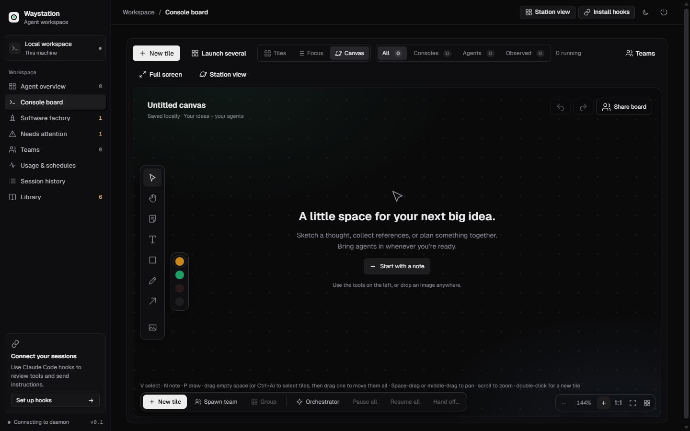

<div align="center">


# Waystation

### Every coding agent on your machine, in one place.

See who is working, who is waiting, and who needs a decision across Claude Code, Codex, GitHub Copilot and ACP agents.
Approve tool calls, run agents in terminals on a shared canvas, and coordinate mixed-provider teams from one local workspace.


[**Quick start**](#-quick-start) · [**Features**](#-why-waystation) · [**A closer look**](#-a-closer-look) · [**Full guide**](Agent_Inspection/README.md) · [**Report an issue**](https://github.com/dolamquan/waystation/issues)

<br />



<br />

<a href="video/promo/out/waystation-promo.mp4">
  
</a>

<sub>▶ <a href="video/promo/out/waystation-promo.mp4"><b>Watch the full-quality promo</b></a></sub>

</div>

<br />

> [!NOTE]
> **Waystation is an early preview.** It's ready for you to clone and try, but expect rough edges. Feedback and bug reports are very welcome in [Issues](https://github.com/dolamquan/waystation/issues).

---

## ✨ Why Waystation?

If you run several coding agents at once, you end up juggling terminal tabs, VS Code panels, and permission prompts. Waystation gathers them into one view so you can tell at a glance **who is working, who is stuck, and who needs you**, and act on it without hunting through terminals.

<table>
<tr>
<td width="50%" valign="top">

### 🛰️ One view across vendors
Claude Code, Codex and GitHub Copilot have native managed integrations. Gemini CLI, OpenCode, Qwen Code, Goose and any [ACP v1](https://agentclientprotocol.com) agent register automatically when installed. Other runtimes (Aider, Cursor Agent, Amp, Cline and more) are detected from the process list, and you can add your own discovery rules.

</td>
<td width="50%" valign="top">

### ✋ Intercept and approve
Hold an agent's next tool call, then **approve**, **edit its input**, or **deny it with an instruction**. Message, interrupt, stop, delegate, or attach skills. `N` jumps to the next thing that needs you; `Ctrl K` opens the command palette.

</td>
</tr>
<tr>
<td width="50%" valign="top">

### 🖥️ Console board and canvas
Real Claude Code, Codex and shell terminals as tiles on an infinite canvas, next to sticky notes, sketches, images, files, browser previews and **git worktree** managers. Launch several agents at once and let running sessions message each other through **channels**.

</td>
<td width="50%" valign="top">

### 👥 Mixed agent teams
Put a Claude lead, a Codex builder and a Copilot reviewer on one goal. They share a task board and message each other, each works in its own git worktree, and deliverables collect in an **Outputs** tab. Nothing is merged until you choose to merge it.

</td>
</tr>
<tr>
<td width="50%" valign="top">

### 🏭 Software factory and agent platform
Queue scoped work through a reusable planner → builder → reviewer pipeline with required checks and approval points. Design multipurpose agents in the **Architecture** workspace, deploy them with versioned tools, memory, schedules and webhooks, and evaluate them against datasets.

</td>
<td width="50%" valign="top">

### 🛡️ Guard rails and costs
Every card shows the model, an estimated cost, and how full its context is. The runaway guard steps in on loops, error storms or a per-agent budget. A daily spend cap holds schedules and factory stages, and Waystation warns when two agents edit the same file.

</td>
</tr>
<tr>
<td width="50%" valign="top">

### 🗂️ Session history and review
Search past conversations, review diffs and recorded checks, mark work verified, and resume a closed Claude or Codex session with its original context. Hand any session off to the real CLI in a Windows Terminal tab.

</td>
<td width="50%" valign="top">

### 🔒 Local first
The dashboard listens on `127.0.0.1` only, behind a token that changes on every run. Optional [remote access](Agent_Inspection/README.md#remote-access-optional) pairs your phone over Tailscale with per-device View, Triage or Full permissions.

</td>
</tr>
</table>

---

## 🚀 Quick start

### Requirements

| | Requirement | Notes |
|---|---|---|
| 🪟 | **Windows 10 or 11** | macOS and Linux aren't supported yet |
| 🟢 | **[Node.js](https://nodejs.org) 22.20 or newer** | Check with `node --version` |
| 🔧 | **[Git](https://git-scm.com)** | Needed for cloning, teams and worktrees |
| 🤖 | **[Claude Code](https://docs.claude.com/en/docs/claude-code/overview)** | Installed and signed in with your own account |
| ⚙️ | [Codex CLI](https://github.com/openai/codex), GitHub Copilot, Gemini CLI or another ACP agent *(optional)* | Only for the providers you want to use |

### Install and run

```powershell
git clone https://github.com/dolamquan/waystation.git
cd waystation/Agent_Inspection
npm ci
npm run desktop
```

Waystation opens in its own window. On first launch, **Desktop setup** checks your tools and explains how to connect your agent accounts. A missing optional tool won't stop it from running.

> [!IMPORTANT]
> The first `npm ci` downloads Electron (about 100 MB) and builds the native terminal module, so expect it to take a few minutes.

<details>
<summary><b>Prefer the browser instead of the desktop window?</b></summary>

<br />

```powershell
npm start               # builds the UI if needed, starts Waystation, opens your browser
npm start -- --no-open  # start without opening a browser; use `npm run open` later
```

Press <kbd>Ctrl</kbd>+<kbd>C</kbd> in the terminal to stop it.

</details>

### Connect your existing Claude Code sessions

Click **Install hooks** in the top bar. Waystation adds a small hook to `~/.claude/settings.json` (after backing it up) so it can show, intercept, and instruct the Claude Code sessions you already run in a terminal or VS Code. **Remove hooks** takes them back out.

### Give agents the Waystation tools

Sessions launched from Waystation get its built-in [MCP server](Agent_Inspection/docs/waystation-mcp.md) automatically, so they can create notes and tiles, open files and previews, and show results on the canvas. To connect agents you start yourself:

```powershell
npm run mcp:configure -- --apply
```

### Stopping Waystation

Closing the window keeps Waystation running in the system tray. To shut it down, right-click the tray icon and choose **Quit Waystation**.

---

## 🔍 A closer look

### Agent overview

Live sessions appear on the **station**: a calm node canvas grouped by project folder, where each session keeps one identity mark, subagents branch from their parent, teams are framed groups, and held tool calls can be approved right in place. No agents running yet? **Explore the demo** shows a labeled sample crew without launching anything.

<div align="center">

</div>

### Console board

Open real terminals as tiles and plan around them. Switch between **Tiles**, **Focus** and **Canvas** layouts, sketch an architecture, drop in references, and spawn a team or an orchestrator straight from the board.

<div align="center">

</div>

### Everything in the sidebar

| Section | What it's for |
|---|---|
| **Agent overview** | The station, live counts, and the *While you were away* recap |
| **Console board** | Terminal tiles, canvas, channels, worktrees and teams |
| **Software factory** | Planner → builder → reviewer pipelines with checks and approvals ([guide](Agent_Inspection/docs/software-factory.md)) |
| **Architecture** | Design, deploy and evaluate multipurpose agents ([guide](Agent_Inspection/docs/architecture-workspace.md), [platform](Agent_Inspection/docs/agent-platform.md)) |
| **Needs attention** | Held tool calls, questions, guard alarms and factory decisions |
| **Teams** | Task boards, conversation, outputs, diffs and merges |
| **Usage & schedules** | Spend, plan windows, spend cap, schedules, setup checks, providers, remote access |
| **Session history** | Search, review and resume past conversations |
| **Library** | Skills, docs, MCP servers, plugins and integration secrets for agent loadouts |

### How much control do you get?

| Badge | Which agents | See live | Intercept / instruct | Stop |
|---|---|:---:|:---:|:---:|
| **Full control** | Agents launched from Waystation (Claude, Codex, Copilot, ACP agents) | ✅ | ✅ per adapter capabilities | ✅ |
| **Hook control** | Your own Claude Code sessions (terminal or VS Code) | ✅ | ✅ after installing hooks | ✅ |
| **Observe only** | Editor Codex threads; other detected agent runtimes | ✅ | — | Standalone CLIs only |

---

## 🧭 How it works

```
 ┌──────────────┐  hooks / SDKs / ACP / PTY   ┌─────────────────────┐  token-protected  ┌──────────────┐
 │ Claude Code  │ ──────────────────────────▶ │                     │ ◀───────────────▶ │ Desktop app  │
 │ Codex        │                             │  Waystation daemon  │  HTTP + WebSocket │  or browser  │
 │ Copilot, ACP │ ◀─── approvals, messages ── │  (127.0.0.1 only)   │                   │      UI      │
 └──────────────┘                             └─────────────────────┘                   └──────────────┘
                                                         │ local SQLite
                                                         ▼
                                              %LOCALAPPDATA%\agent-tower
```

- A local **daemon** (Node + TypeScript) discovers sessions from Claude Code's session registry and transcripts, Codex rollouts, and a process scan backed by a shared discovery catalog.
- **Managed agents** run through native Claude, Codex and Copilot adapters or the shared ACP v1 adapter. Messaging, approvals and recovery reflect each adapter's capabilities, and provider selectors update automatically as you install or configure agents.
- **Console tiles** are real pseudo-terminals (`node-pty`) streamed to the UI, so Claude Code and Codex behave exactly as they do in your own terminal.
- Your **existing Claude Code sessions** report in through a small hook script. If Waystation isn't running, Claude Code behaves exactly as before.
- The **UI** is React, dark by default with a light theme, served to an Electron window or your browser.
- Runtime data (database, per-run token, backups) is kept in `%LOCALAPPDATA%\agent-tower`, outside your repositories.

---

## 🛠️ Troubleshooting

<details>
<summary><b><code>npm ci</code> fails or Electron won't download</b></summary>

<br />

Make sure you're on Node 22.20 or newer (`node --version`) and running from the `Agent_Inspection` folder. If you're behind a proxy, Electron's download may need `ELECTRON_MIRROR` or proxy settings for npm.

</details>

<details>
<summary><b>My Claude Code sessions don't show up</b></summary>

<br />

Sessions started *before* you clicked **Install hooks** may need a restart to pick up the hooks. If `claude.exe` isn't in the npm global folder or on `PATH`, set `AGENT_TOWER_CLAUDE_EXE` to its location.

</details>

<details>
<summary><b>An agent I installed isn't listed as a provider</b></summary>

<br />

Gemini CLI, OpenCode, Qwen Code and Goose register from `PATH` within about ten seconds. For any other ACP agent, use **Usage & schedules → Setup checks → Connected agent providers → Connect another ACP agent**. See [dynamic provider connections](Agent_Inspection/README.md#dynamic-provider-connections).

</details>

<details>
<summary><b>Teams refuse my project folder</b></summary>

<br />

The folder must be the top of its own git repository, not a subfolder of a larger one. If it isn't a repo yet, tick **Set up git** in the New team dialog. Worktrees only contain committed files, so commit first.

</details>

<details>
<summary><b>Where is my data stored? How do I reset?</b></summary>

<br />

Everything is in `%LOCALAPPDATA%\agent-tower`. Quit Waystation and delete that folder for a clean start. Remove hooks first if you installed them.

</details>

More detail is in the [desktop setup guide](Agent_Inspection/docs/desktop.md) and the [full feature guide](Agent_Inspection/README.md).

---

## ⚠️ Known limits

- **Windows only** for now.
- **Team sandboxes prevent accidents, but they aren't a security boundary.** Members run as your Windows user, and shell commands aren't covered by the worktree file guard. Treat Intercept on team members as a convenience.
- Managed agents load your user Claude settings (plugins, MCP servers, global hooks), so each turn may be slower and cost more.
- Costs are **estimates** at list price. Subscription plans (including Copilot premium requests) are billed differently.
- Process discovery shows that a runtime is running, not its individual conversations; managed controls need a native adapter or ACP.

---

## 🧑‍💻 Development

```powershell
cd Agent_Inspection
npm run daemon:dev   # daemon that also trusts the Vite dev server
npm run dev:web      # Vite dev server on http://127.0.0.1:5173
npm run attach       # text-only console that follows an agent or team
npm test             # Vitest unit + integration tests
npm run typecheck
```

The project layout, security model and the full feature reference are in [`Agent_Inspection/README.md`](Agent_Inspection/README.md). Feature deep-dives live in [`Agent_Inspection/docs/`](Agent_Inspection/docs/).

---

## 💬 Feedback

This is an early preview, and testers make it better. If something breaks, confuses you, or you have an idea, please [open an issue](https://github.com/dolamquan/waystation/issues). Screenshots help a lot.

## 📄 License

A license hasn't been chosen yet. Until one is added, you're welcome to clone and try Waystation, but please ask before redistributing or reusing the code. The bundled [Geist](https://github.com/vercel/geist-font) and [Source Sans 3](https://github.com/adobe-fonts/source-sans) fonts are under the SIL Open Font License (`Agent_Inspection/web/public/fonts/`).

<div align="center">
<br />
<sub>Built for people who run more agents than they have terminal tabs. 🛰️</sub>
</div>
